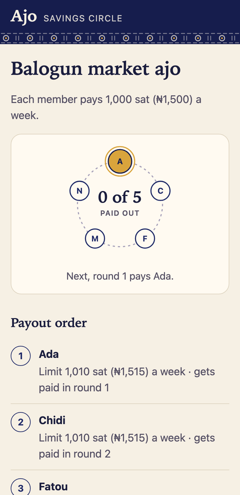
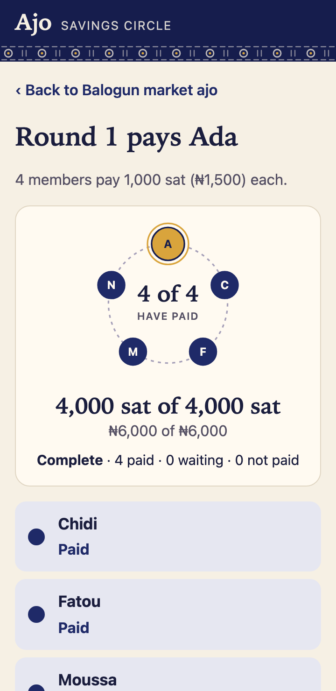
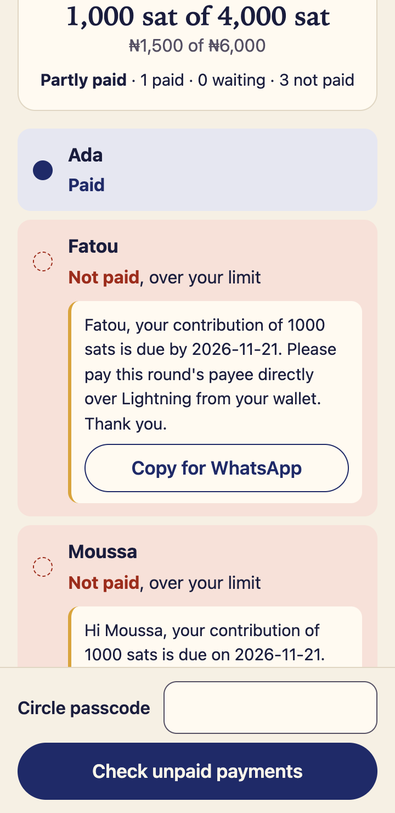
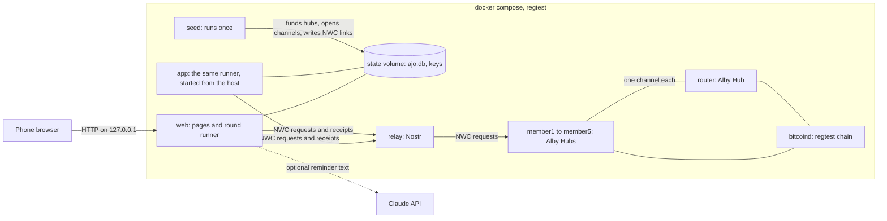

# Ajo on Lightning

A rotating savings circle (ajo, esusu, tontine) where nobody holds the pot. Each round, every member's own Lightning wallet pays that round's payee directly through Nostr Wallet Connect (NWC). Built for the [Dakar Bitcoin Hack 2026](https://dakar-bitcoin-hack-2026.devpost.com/).

<p>



</p>

Watch the 3-minute demo: [docs/media/demo.mp4](docs/media/demo.mp4).

## Who it's for

**The circle organiser**, often the woman who already runs a market traders' ajo or tontine, with 5 to 20 members.

| Her week | Today | With Ajo on Lightning |
| --- | --- | --- |
| Collecting | Visits stalls or waits for transfers | Presses **Collect this round**; each member's wallet pays the payee |
| Holding the pot | The circle's savings depend on her | She holds nothing |
| Chasing late payers | Calls each one | Each row says who paid and why not; a reminder copies into WhatsApp |
| Proving who paid | Her word | A signed Nostr receipt for every payment |

**Reach (estimate):** one weekly circle of 10 serves 10 people and 9 payments a week, or 468 payments a year. A pilot of 10 circles would serve 100 members a week.

## Run the demo

You need Docker.

```sh
docker compose up
```

This boots bitcoind, a Nostr relay, a router and five member Alby Hubs on regtest. When the log shows `seed done`, open <http://127.0.0.1:8000>.

1. **Start a circle** with a name, an amount (up to 1000 sat on the demo stack), how often members pay, a reminder language and a passcode.
2. **Join five members.** Each pastes a pay link and a receive link from their wallet, or picks one of the five demo wallets.
3. **Collect round 1.** Type the passcode and press **Collect this round**. Each row turns to **Paid**.
4. **See the receipts.** Anyone can read them, without the passcode.

`docker compose down -v` starts over. Set `ANTHROPIC_API_KEY` before `up` to have Claude Haiku write the reminders.

## How it works



- **Least privilege.** The pay link can only pay, up to a limit the member's own wallet enforces. The receive link can only create invoices. Ajo checks both at join and refuses a link that can do more than its job.
- **Hold invoices.** The payee's wallet holds each payment until Ajo releases it. A late payment is never released, so a member shown as not paid is never charged, and a rerun never mints a new invoice.
- **Receipts.** Each payment gets a signed Nostr receipt with no names.
- **Reminders.** Claude Haiku writes them in English, Pidgin, Yoruba, French or Wolof. It sees only the language, the seat, the amount and the due date; the server adds the name.
- **Secrets.** Names and NWC links are sealed in the database, the passcode is a salted scrypt hash with a rate limit, and every port binds to `127.0.0.1`.

[docs/architecture.md](docs/architecture.md) walks through a round step by step. [docs/threat-model.md](docs/threat-model.md) lists each control with its evidence.

## Check it yourself

With Node 22.18 or newer, run `npm ci`, then:

- `npm test` for the unit tests, including 1000 random runs against the TLA+ model's rules.
- `./scripts/e2e` on a fresh stack (`docker compose down -v && ./scripts/up`). It checks the payee's hub and the relay, not the runner's word.
- [model/README.md](model/README.md) for the TLA+ model, which holds all five rules over 7,280,499 states.

## Constraints

- Regtest only, with fixed passwords. Not safe for real sats as it stands.
- One stack runs one circle. The organiser presses a button to collect each round.
- Hosting for other phones needs TLS and a persistent passcode counter.
- Naira amounts use a fixed demo rate of ₦1,500 per 1,000 sat.

## Metrics

| Metric | On the demo stack |
| --- | --- |
| Collect to a complete round of 4 payers | About 1.3 seconds |
| Routing fee per 1000 sat payment | 1 sat |
| Page weight | 11 to 14 KB, one request |
| Fresh clone to a collected round | 77 seconds (median of 3) |
| Members shown as not paid who were charged | 0 (`scripts/e2e` check 2) |

A pilot would also track the share of rounds that complete, why members show as not paid, and how many joins are refused.

## Next iteration

- A mainnet pilot circle, with members joining from mobile wallets that support NWC.
- Ask Alby Hub to refund a payment that arrives after a cancel at once.
- Host the pages with TLS and many circles per server.
- Collect each round on its due date automatically.

## More docs

[Architecture](docs/architecture.md) · [Threat model](docs/threat-model.md) · [Demo script](docs/demo-script.md) · [Devpost text](docs/devpost.md) · [TLA+ model](model/README.md)
