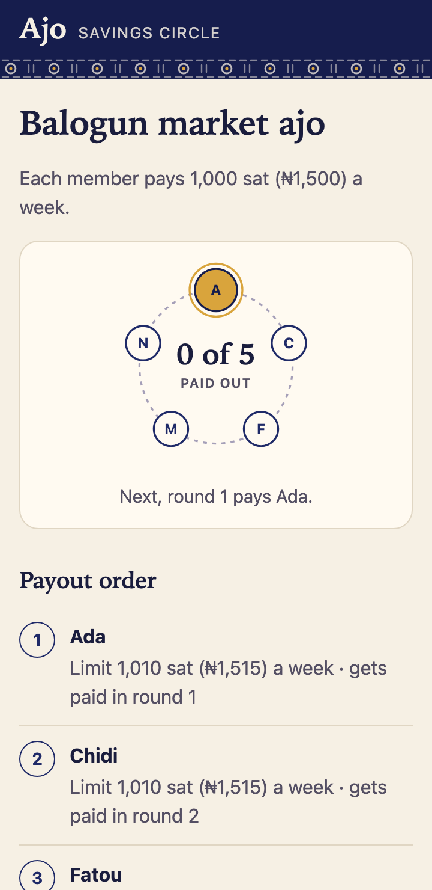
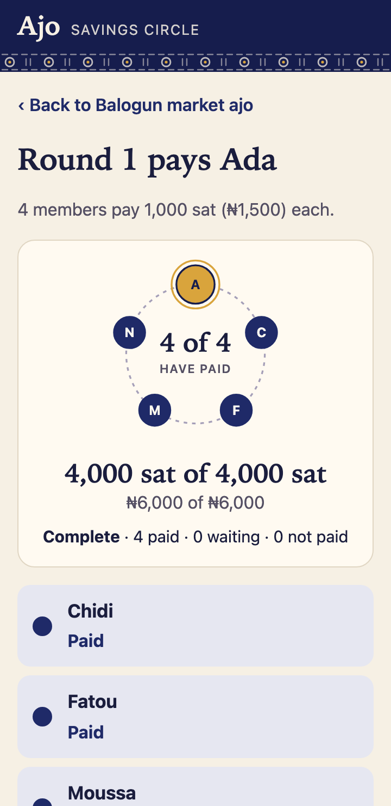
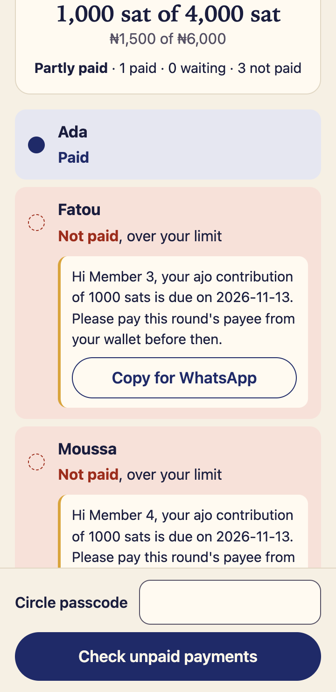
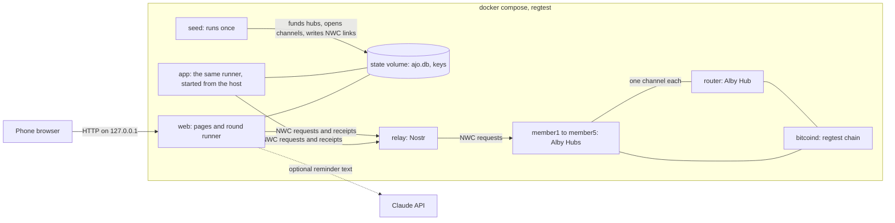

# Ajo on Lightning

A rotating savings circle (ajo, esusu, tontine) where members pay each other directly over Bitcoin Lightning. Each round, every member's own wallet pays that round's payee through Nostr Wallet Connect (NWC). The app never holds a pot.

Built for the [Dakar Bitcoin Hack 2026](https://dakar-bitcoin-hack-2026.devpost.com/).

<p>



</p>

[docs/media/demo.mp4](docs/media/demo.mp4) is the 2.5-minute demo, recorded on the live regtest stack with an Anthropic key set, so the reminders on screen come from Claude Haiku. [docs/media/quickstart-round.mp4](docs/media/quickstart-round.mp4) records the steps below on the demo stack, from an empty circle to round 1's receipts, in 10 seconds.

## Run the demo

You need Docker. From the repo root, run:

```sh
docker compose up
```

The first run builds the web image. Then it boots bitcoind, a Nostr relay, a router hub and five member Alby Hubs on regtest, and opens a channel from each member to the router. When the log shows `seed done`, open <http://127.0.0.1:8000> on the same machine.

1. Start a circle. Choose a name, the sats each member pays, how often they pay, the reminder language and a passcode of at least 6 characters. Share the passcode only with the members. Each demo wallet can pay up to 1010 sat a week. That covers a 1000 sat contribution and its routing fee, so on this stack the form refuses more than 1000 sat. To try a bigger amount, start over with `docker compose down -v`, then run `CONTRIBUTION=5000 docker compose up`.
2. Join five members. Each member types the passcode and pastes a pay link and a receive link from their wallet. On this stack, a member can pick one of the five demo wallets instead.
3. Open round 1 from the circle page. Round 1 pays the first member who joined. Type the passcode and press **Collect this round**. Each row turns to **Paid** when that payment reaches the payee's wallet, and the round reads **Complete**.
4. Open **See the receipts**. Anyone can read the receipts without the passcode.

The page binds to 127.0.0.1 only. To use another host port, set `WEB_PORT`. After you change the code, run `docker compose up --build`. To start again from nothing, run `docker compose down -v`.

To run the pages without Docker on in-memory wallets, run `npm ci` once, then `AJO_SOURCE=fake npm run web`.

## What a circle checks

- At join, Ajo asks each wallet what its link may do with NWC `get_info` and `get_budget`. It refuses a wallet that does not answer and a receive link that can pay. It also refuses a receive link without `make_hold_invoice`, `settle_hold_invoice`, `cancel_hold_invoice` and `lookup_invoice`. In Alby Hub, the "create invoices" and "look up invoices" permissions give all four.
- A pay link must not make invoices. Its limit must renew at least as often as the circle pays, so daily or weekly for a weekly circle and daily, weekly or monthly for a monthly one. It must cover the contribution plus a routing fee of 1% or 10 sat, whichever is more. For a 1000 sat contribution that is 1010 sat. Ajo refuses a pay link whose unused limit is under that amount.
- Each payment uses a hold invoice. The payee's wallet holds the sats until Ajo releases them with a secret only Ajo keeps. When an invoice expires unpaid, Ajo never releases it and cancels it. A payment that arrives late goes back to the payer, so a member shown as not paid is never charged. A rerun of a round checks unpaid payments and never mints a new invoice. It cancels the expired invoices again.
- The organiser sets the passcode when they start the circle. Ajo keeps only a salted scrypt hash of it. Joining and collecting need the passcode. After five wrong tries from one address, that address waits 15 minutes.
- The store seals member names and NWC links with `AJO_SECRET_KEY`. Pages and logs never show a link after it is pasted.

## Keys

Before any host command has written `.env`, the stack keeps its own `AJO_SECRET_KEY` and `AJO_CIRCLE_KEY` in `keys.env` in its state volume. `node src/run-round.ts <round>` copies that pair to `.env` on its first run, or writes a new pair when the stack has none. `AJO_SECRET_KEY` seals member names and NWC secrets in the stack's database, so keep `.env`. An `AJO_SECRET_KEY` exported in your shell overrides the one in `.env`. If the runner says the database was sealed with a different key, restore the original `.env` and unset any exported key, or run `docker compose down -v` to start fresh.

## Reminders

The round page shows a reminder on each member row that is waiting or not paid, with a **Copy for WhatsApp** button. `scripts/remind` prints a payment reminder for one member in English (`en`), Nigerian Pidgin (`pcm`), Yoruba (`yo`), French (`fr`), or Wolof (`wo`). Run `npm ci` once first.

```sh
scripts/remind --lang fr --amount 4000 --due 2026-11-12 --member 3
```

`ANTHROPIC_API_KEY` is optional. Export it before `docker compose up` to pass it to the web service. With a key, Claude Haiku 5.5 (`claude-haiku-5-5`) writes the message and sees only the language, the seat label, the amount, and the due date. Without a key, or when the call fails or takes longer than 3.5 seconds, the script prints a fixed template. The round page never waits for the model. It shows the template first and the model's text on a later load. A bad argument prints the usage line and exits 2.

## How it works

Each member runs their own Alby Hub, a Lightning node with a wallet, and has one channel to a router hub. The `web` service serves the pages and runs each round. It talks to the wallets only through NWC requests on the Nostr relay, and it keeps its records in a SQLite database in the `state` volume.



For each payer, the runner asks the payee's wallet for a hold invoice, then asks the payer's wallet to pay it. The payee's wallet holds the payment until the runner settles it with a secret that only the runner keeps. [docs/architecture.md](docs/architecture.md) walks through a round step by step, and [docs/threat-model.md](docs/threat-model.md) lists each control with its evidence.

## Check it yourself

You need Node 22.18 or newer on the host for these commands. Run `npm ci` once.

- `npm test` runs the unit tests, including 1000 random runs of the round core against the rules of the TLA+ model.
- `./scripts/e2e` runs round 1 and round 2 through the runner on a fresh stack. It checks the payee's hub and the relay, not the runner's word. Start the stack with `docker compose down -v`, then `./scripts/up`. Expect `PASS check 1`, `PASS check 3`, `PASS check 4` and `PASS check 2`.
- [model/README.md](model/README.md) gives the TLC commands for the TLA+ model of a round. The design that the code follows holds all five rules over 7,280,499 states.

## Constraints

- The demo runs on regtest, with fixed passwords in `docker-compose.yml`. It is not safe for real sats as it stands.
- One stack runs one circle. The demo stack makes five member wallets.
- Each demo wallet may pay 1010 sat a week, so a demo circle's contribution is at most 1000 sat unless you set `CONTRIBUTION`.
- Every port binds to `127.0.0.1`. Hosting the pages for other phones needs TLS and a passcode counter that survives a restart, as the threat model explains.
- The organiser presses a button to collect each round. Nothing collects on a schedule yet.
- The naira amounts use a fixed demo rate of ₦1,500 per 1,000 sat, not a live price.

## Metrics

These numbers come from runs on this stack. A pilot would track the same ones.

| Metric | On the demo stack |
| --- | --- |
| Time from pressing collect to a complete round of 4 payers, seen in the browser | About 1.3 seconds |
| Routing fee per 1000 sat payment | 1 sat |
| Page weight, one request, no image files or web fonts | 11 to 14 KB |
| Time from a fresh clone to a collected round, images pulled, with a script typing into the pages | 77 seconds, the median of 3 runs. The seed takes 11 to 15 of them. |
| Members shown as not paid who were charged | 0. `scripts/e2e` check 2 reads each such member's hub balance. |

A pilot would also track the share of rounds that end complete, the reasons members show as not paid, and how many joins the link checks refuse, by reason.

## Next iteration

- Run real hubs on mainnet for a small pilot circle, and let members join from mobile wallets that support NWC.
- Ask Alby Hub upstream to refund a payment that arrives after a cancel at once, instead of holding it until the claim deadline, and to offer hold invoices as their own permission.
- Host the pages with TLS, a persistent passcode counter and more than one circle per server.
- Collect each round on its due date without a button press.

## More docs

- [docs/architecture.md](docs/architecture.md). How a round moves money, step by step.
- [docs/threat-model.md](docs/threat-model.md). Assets, actors, trust boundaries and each control with its evidence.
- [docs/demo-script.md](docs/demo-script.md). The 3-minute demo.
- [docs/devpost.md](docs/devpost.md). The hackathon submission text.
- [model/README.md](model/README.md). The TLA+ model and how to check it.
