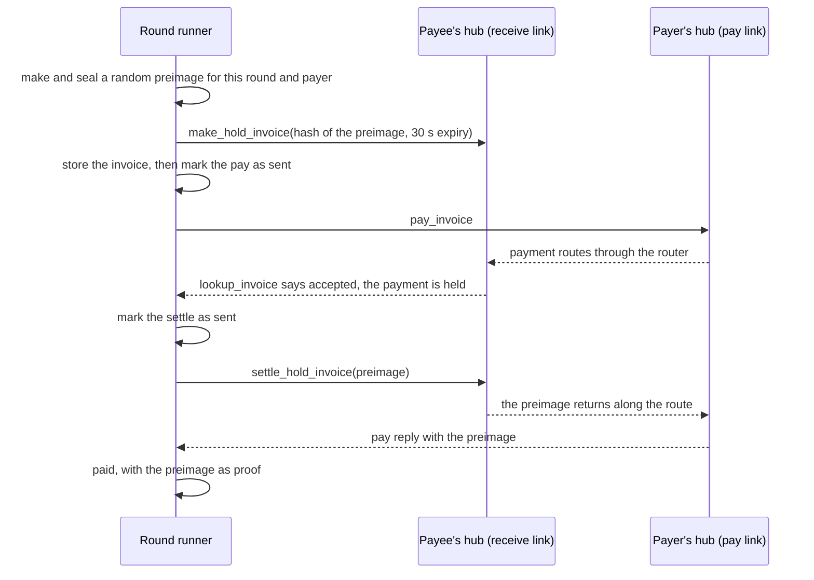

# How Ajo on Lightning moves a round's money

Ajo on Lightning never holds a pot. Each member's own wallet pays the round's payee directly over Lightning. The app only asks wallets to act, through Nostr Wallet Connect (NWC), and records what their answers prove.

## The demo stack

`docker compose up` starts every service in [the diagram in the README](../README.md#how-it-works) on one machine, except `app`, which runs only when a host command starts it. Each member runs their own Alby Hub, a Lightning node with a wallet. The router hub stands in for the public Lightning network. Each member has one channel to it, and it forwards payments between members for a fee of 1 sat.

The `seed` service runs once per stack. It funds each member hub on chain, opens a channel from each member to the router, and has each member buy 50,000 sat of inbound liquidity from the router. Then it makes two NWC connections per member and writes them to `connections.json`. The `app` service is the same round runner as `web`, started from the host with `node src/run-round.ts <round>`, and `scripts/e2e` uses it.

## The two links a member gives

A member joins with two NWC links from their own wallet.

- The pay link may only pay invoices, up to a limit that renews each day, week or month. The wallet enforces that limit, so Ajo can never spend more than it. For a 1000 sat contribution the limit must be at least 1010 sat a period, to cover a routing fee of 1% or 10 sat, whichever is more.
- The receive link may create invoices and look them up, and it cannot pay. In Alby Hub those permissions also allow hold invoices, which Ajo needs.

At join, `checkLinks` in `src/web/nwc-source.ts` asks each wallet what its link may do and refuses a link that can do more or less than its job.

## One round, step by step

Round `n` pays the `n`th member who joined. Every other member pays them one contribution.

The payee's hub holds an incoming payment until the runner sends the preimage. Only the runner has it. That rule decides every failure:

- If the payer's wallet refuses, for example over its limit, no money moves. The row shows "Not paid" with the reason.
- If the invoice expires before the payee's hub holds a payment, the runner never sends the preimage and cancels the invoice. A payment that arrives later fails back to the payer. Alby Hub can hold such a payment until its claim deadline first, as [the threat model](threat-model.md#a-late-payment-after-a-cancel) explains.
- If the runner crashes, the next run looks up every open invoice on the payee's hub before it does anything else. It settles a held payment, and it never pays an invoice a second time.
- A rerun of a partial round checks unpaid payments again and never mints a new invoice. It cancels the expired invoices again, which frees any payment that reached the payee's hub after the first cancel.

A payment counts as paid only with proof. The proof is a preimage that hashes to the invoice, or the payee's hub reporting the invoice settled.

## Where the rules come from

The round's states and events live in `src/round/types.ts`, and `src/round/round.ts` is a pure reducer over them. The runner in `src/run-round.ts` feeds it wallet replies and saves each new state before the next wallet call.

The retry rules were checked first in TLA+. `model/AjoRound.tla` shows that retrying a pay at once can show a paid member as failed, and that minting a new invoice on retry can charge a member twice. The fixed design, which looks the invoice up before any retry and reuses it, holds all five rules over 7,280,499 states. [model/README.md](../model/README.md) has the commands and results.

## Receipts

For each paid contribution the runner signs a Nostr event with the circle's key and publishes it to the relay. The event carries the round, the payer's pseudonym, the amount and the payment hash, and it never carries a name. Anyone can read the receipts page, or query the relay for the tag `ajo-receipt` and check each signature against the circle key.

## Reminders

Each unpaid row on the round page has a reminder in the circle's language: English, Nigerian Pidgin, Yoruba, French or Wolof. With `ANTHROPIC_API_KEY` set, Claude Haiku writes the message from the language, the seat number, the amount and the due date. Without a key, or when the call fails or takes longer than 3.5 seconds, the page shows a fixed template. Either way, the page then swaps the seat label for the member's name, so the name never leaves the server.
